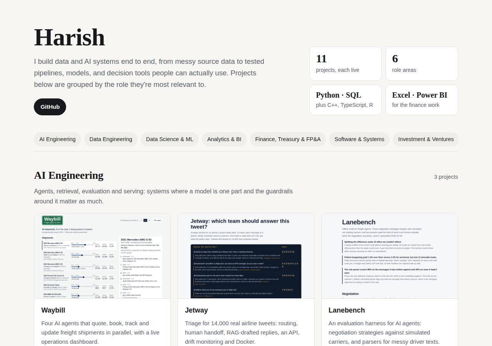

# Portfolio

**Live:** https://harish04010-portfolio.vercel.app

Fourteen end-to-end projects, grouped by the role they're most relevant to. Each has a live demo, tested code, and a README explaining the decisions, results and limitations.

| Area | Projects |
|---|---|
| AI Engineering | [Waybill](https://github.com/harish04010/waybill) · [Jetway](https://github.com/harish04010/jetway) · [Lanebench](https://github.com/harish04010/lanebench) |
| Data Engineering | [Supply Chain Data Platform](https://github.com/harish04010/supply-chain-data-platform) · [Market Data Lakehouse](https://github.com/harish04010/market-data-lakehouse) · [Ridgeline Analytics](https://github.com/harish04010/ridgeline-analytics) |
| Supply Chain & Operations | [Supply Chain Data Platform](https://github.com/harish04010/supply-chain-data-platform) · [Demand Forecasting & Inventory Policy](https://github.com/harish04010/demand-inventory-planning) · [Purchasing & Production Improvement](https://github.com/harish04010/purchasing-production-improvement) · [Waybill](https://github.com/harish04010/waybill) · [Haulroute](https://github.com/harish04010/haulroute) · [Lanebench](https://github.com/harish04010/lanebench) |
| Data Science & ML | [Credit Risk Scorecard](https://github.com/harish04010/credit-risk-scorecard) · [Card Fraud Detection](https://github.com/harish04010/card-fraud-detection) · [Retention Targeting](https://github.com/harish04010/retention-targeting) · [Jetway](https://github.com/harish04010/jetway) |
| Analytics & BI | [Ridgeline Analytics](https://github.com/harish04010/ridgeline-analytics) · [Retention Targeting](https://github.com/harish04010/retention-targeting) · [Card Fraud Detection](https://github.com/harish04010/card-fraud-detection) · [FP&A Operating Plan](https://github.com/harish04010/fpa-operating-plan) |
| Finance, Treasury & FP&A | [Treasury Reconciliation](https://github.com/harish04010/treasury-recon) · [FP&A Operating Plan](https://github.com/harish04010/fpa-operating-plan) · [Credit Risk Scorecard](https://github.com/harish04010/credit-risk-scorecard) |
| Software & Systems | [Haulroute](https://github.com/harish04010/haulroute) · [Waybill](https://github.com/harish04010/waybill) · [Market Data Lakehouse](https://github.com/harish04010/market-data-lakehouse) |
| Investment & Ventures | [Academy Sports (ASO) equity research](https://harish04010-portfolio.vercel.app/cases/aso/) · [Seed memo: AI agents for freight brokers](https://harish04010-portfolio.vercel.app/cases/venture/) · [Tech commercialization: ORNL battery recycling](https://harish04010-portfolio.vercel.app/cases/techcomm/) |

## Editing

Everything is in `index.html`. Your name, tagline and links are in the `ME` block at the top of the script; projects are in `P`, and the role sections that list them are in `ROLES`. A project can appear in as many sections as fit. Screenshots are in `img/` (720 px wide WebP).

No build step: Vercel serves the folder as a static site.
